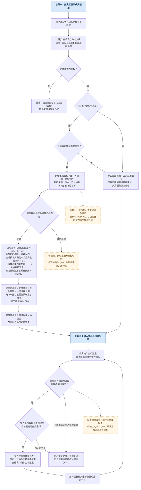
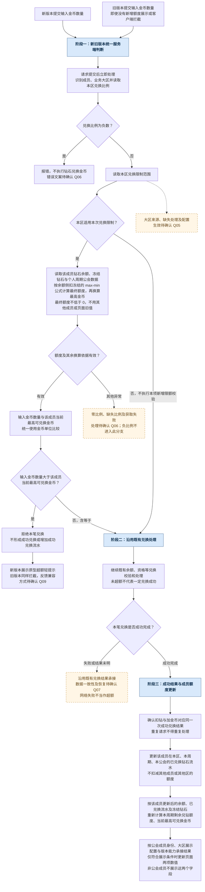
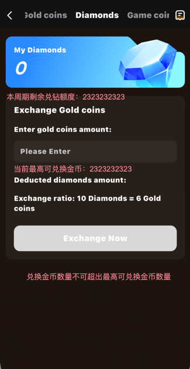
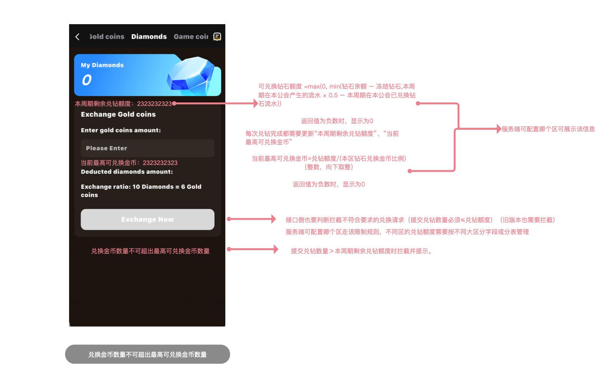

# 土区兑换钻石限制需求文档

> 范围：当前打开的《土区兑换钻石限制.rp》，共 1 个页面。本文件是现有“钱包－钻石兑换金币”的限制规则增补，不替代整套用户分区需求。页面字段、最新画布旁注及用户已确认规则为依据；用户确认口径优先于旁注中的旧表述，剩余未定义口径集中列于 6.1，不能按示例或本文推演自行定稿。

## 1. 产品概述与目标

在现有钻石兑换金币页面增加本周期剩余额度、最高可兑换金币数量及超额提示。其中“本周期剩余兑钻额度”“当前最高可兑换金币”仅向公会成员展示，且仍需满足本区展示配置；非公会成员不展示这两个新增字段。服务端按大区配置是否展示额度信息、是否执行兑换限制，并对旧版本同样执行适用的限制规则；额度属于每个成员，每名成员分别计算和使用；不同大区的兑钻额度分别管理。

**兑换方向：** 用户输入希望获得的金币数量，系统扣除相应钻石，兑换获得金币。原型使用“兑钻”作为限制规则的简称，本文保留“本周期剩余兑钻额度”这一页面名称，不将其解释为“金币兑换钻石”。

**本次包含：** 额度与上限展示、额度公式、超额拦截与提示、兑换完成后的信息更新、分区适用配置、大区额度数据隔离、旧版本拦截。

**既有功能：** 钻石余额、金币数量输入、预计扣钻、兑换比例和兑换按钮继续使用现有兑换页面。与本次额度无关的充值、游戏币兑换、BD／公会可提现余额兑换不在本文展开；不新增后台配置页面、查询列表或人工额度调整功能。

## 2. 系统角色定义

| 角色 | 本次行为与边界 |
| --- | --- |
| 兑换用户 | 在现有钱包钻石页输入目标金币数量、查看兑换信息并提交兑换；两项新增额度字段仅公会成员且本区启用展示时可见；既有兑换资格不变，服务端限制适用身份等剩余边界见 Q03。 |
| 服务端 | 根据用户业务大区判断展示与限制范围，提供额度结果、执行兑换额度校验，并更新本周期已兑换数据。 |
| 配置维护方 | 维护适用大区；原型未指定人员角色、维护入口与授权方式，不据此新增运营页面或权限角色。 |

## 3. 核心规则

### 3.1 原型与规则位置

本次原型的页面、超额提示及配置旁注分别对应 4.1.1、4.2.1、5.1.1；原型图随对应功能点展示。

### 3.2 剩余额度与金币上限

| 规则 | 规则内容 | 使用说明 |
| --- | --- | --- |
| 本周期剩余兑钻额度 | max（0，min（该成员当前钻石余额 − 该成员冻结钻石，该成员本周期在本公会产生的流水 × 0.5 − 该成员本周期在本公会已兑换钻石流水）） | 余额先扣冻结钻石，再与个人周期流水剩余量取较小值，最终不低于 0。每个成员独立计算和使用，不使用公会整体流水或其他成员额度；0.5 不新增可配项。周期、流水来源及单位见 Q01～Q03。 |
| 当前最高可兑换金币 | 兑钻额度 ÷ 本区钻石兑换金币比例，结果向下取整 | 使用上行已纳入钻石余额的兑钻额度，返回值为负数时显示为 0；比例为负数时优先报错阻止提交，不因显示为 0 放行。比例方向及扣钻取整见 Q04。 |
| 超额判断 | 输入金币数量必须 ≤ 当前最高可兑换金币；超过时拦截并提示 | 客户端与服务端均比较该成员的输入金币数量与当前最高可兑换金币，不拿输入金币与剩余钻石额度直接比较。等于上限不属于本项超额拦截，但仍受既有余额等规则约束。 |
| 完成后更新 | 每次兑钻完成都需要更新“本周期剩余兑钻额度”“当前最高可兑换金币” | 同一次兑换完成后，两项按更新后的已兑换数据重新计算并展示。 |

**冻结钻石与余额口径：** 当前钻石余额为尚未扣除本次冻结限制的余额。冻结钻石沿用现有兑换逻辑计算：冻结钻石＝现有逻辑读取的已预支美元 × 35,000。余额可兑换钻石＝max（当前钻石余额 − 冻结钻石，0）；个人周期剩余额度＝本周期在本公会产生的个人流水 × 0.5 − 本周期在本公会已兑换钻石流水；最终取这两条限制的较小值，并保证不低于 0。页面“本周期剩余兑钻额度”展示此最终可兑换钻石额度，“当前最高可兑换金币”基于该最终额度换算。

冻结钻石只在余额侧扣除一次，不从周期流水侧再次扣除，也不在最终额度外再减一次。既有冻结校验继续保留为同一余额约束的校验，不再次减少公式结果。冻结数据沿用现有预支工资逻辑，不新增冻结／解冻操作或客户端展示字段；已预支金额的具体取数范围与更新时点等剩余口径见 Q11。

**数值不是配置：** 两处 `2323232323` 和余额 `0` 均为原型示例，不是额度默认值、固定上限或上线初始余额。原截图中的 `10 Diamonds = 6 Gold coins` 是示例兑换比例，实际读取本区配置，不在本次写死该数值。

**负数展示与提交边界：** 两项返回值为负数时均显示为 0，不展示负数；这只确认数值展示，不代表兑换成功或允许绕过上限。正数金币输入超过当前最高可兑换金币时按原超额规则拦截；是否置灰按钮、占位等未指定交互不擅自增加。负兑换比例优先报错并阻止提交；零比例、缺失比例等不能靠负值显示规则兜底，仍见 Q06。

**已确认金额口径：** 原型旁注中的“提交兑钻数量”统一按“输入金币数量”执行；前后端均将其与该成员的“当前最高可兑换金币”比较。兑换比例为负数时报错，不允许提交钻石兑换金币请求；服务端也不得按负比例执行兑换，错误文案见 Q06。比例方向、换算精度与扣钻取整仍待 Q04 确认。

### 3.3 分区展示与限制

1. “本周期剩余兑钻额度”“当前最高可兑换金币”仅公会成员可见，并由服务端配置哪些大区展示。展示条件为“当前用户是公会成员”且“当前大区在额度信息展示范围内”；非公会成员或本区未启用展示时，均不展示这两个字段，其余既有页面按原功能展示。本次身份限制仅针对这两个新增字段，不据此改变兑换资格、提示文案或服务端限制适用范围。
2. 服务端可配置哪些大区执行本次兑换限制。纳入限制范围的请求，无论客户端是否展示新信息，都要执行服务端额度校验。
3. 展示范围与限制范围是原型分别描述的两项配置能力。两者是否必须保持一致、初始启用哪些大区，见 Q05；不得仅因文档名为“土区”而写死只允许土区或默认其他区全部关闭。
4. 不同大区的兑钻额度分别管理，同一区内各成员额度也分别管理，不得混用其他成员或其他大区的额度、流水及已兑换数据。原型所写“分字段或分表”表达的是数据隔离要求，不在本 PRD 指定实现方式。
5. 分区兑换比例沿用本区钻石兑换配置。不得借用应用商店套餐、游戏币兑换或可提现余额兑换的比例。

### 3.4 校验链路与旧版本

| 阶段 | 本次处理 |
| --- | --- |
| 页面展示 | 同时满足公会成员身份与本区展示配置时才展示两项新信息；非公会成员不展示；获取当前成员钻石余额、冻结钻石、本周期本公会个人流水及本区比例，按余额侧扣冻结的 max-min 公式计算；最终额度不低于 0。 |
| 用户输入金币 | 沿用现有输入与预计扣钻能力，新增最高可兑换金币的约束。客户端超额反馈见 4.2。 |
| 提交兑换 | 请求提交后立即处理。服务端按本次成员及实际业务大区判断是否适用限制；适用时，将输入金币数量与该成员当前最高可兑换金币比较，不以旧页面展示值代替最终校验。 |
| 负兑换比例 | 兑换比例为负数时报错，客户端阻止提交钻石兑换金币请求；服务端不得按负比例执行兑换。此规则不依赖新增额度信息是否展示。 |
| 超额 | 不执行本次兑换，反馈“兑换金币数量不可超出最高可兑换金币数量”。 |
| 未超额 | 继续既有兑换校验和处理；不是绕过余额及现有兑换条件。 |
| 兑换完成 | 更新该成员本周期在本公会已兑换钻石流水，并结合当前钻石余额和冻结钻石重新计算该成员两项额度展示结果；不扣减其他成员额度。失败或结果未明时的数据一致性及恢复见 Q07。 |
| 旧版本请求 | 即使没有额度展示或客户端拦截，纳入限制范围的请求仍由服务端拦截。旧版本提示承接方式见 Q09。 |

**同笔结果一致性：** 沿用既有规则，同笔兑换只对应一次扣钻与加金币；重复请求不能重复扣钻、加金币或扣减该成员额度。失败或结果未明时的数据一致性与恢复按 Q07 确认，不自行增加新的业务状态。

### 3.5 业务流程图

以下两张图串联页面展示、用户输入、服务端限额及兑换完成后的更新。展示范围与限制范围分别判断；图中“待确认”节点仅表示规则缺口，不代表已确定的运行状态或异常处置方案。输入金币比较、成员独立额度及负比例阻止提交按已确认规则执行；其余公式换算、单位与周期以 3.2、6.1 为准，不从图中另行推导默认值。

#### 3.5.1 额度展示与输入校验流程

#### 3.5.2 服务端限制与兑换完成后更新流程

**流程边界：**
- 两项新增字段仅向公会成员且本区启用展示时展示；非公会成员隐藏这两个字段，不据此改变服务端限制适用范围。展示配置不代替限制配置。没有新增展示或客户端校验能力的请求，仍进入服务端最终判断；旧版本不豁免。
- 客户端与服务端均比较“输入金币数量”与“该成员当前最高可兑换金币”。超过才按本项拦截，等于时继续既有兑换校验。
- 超额轻提示文案为“兑换金币数量不可超出最高可兑换金币数量”；客户端提示时点、旧版本承接分别待 Q08、Q09 确认。
- 更新以兑换成功完成为前提，两项额度结果使用该成员更新后的同区、同周期、同公会数据，不共用或扣减其他成员额度。失败或结果未明的数据一致性与恢复仍待 Q07 确认。
- 兑换比例为负数时报错并阻止提交；服务端也不按负比例执行兑换。兑钻额度已按扣冻结后的余额与个人周期流水剩余量取较小值，并保证不低于 0，两项负返回值显示为 0。其余周期定义、公会资格、零比例或缺失比例、分区配置等继续按 Q01～Q09 待确认，不擅定结转或异常放行。

## 4. 客户端功能模块

### 4.1 钻石兑换金币页面：额度与最高可兑换金币

#### 模块背景

在既有兑换页告知用户当前周期的兑换上限。

#### 用户场景

用户进入钱包钻石页，在输入希望获得的金币数量前查看剩余额度和金币上限；兑换完成后继续查看更新结果。

#### 对应原型

本模块使用下方 4.1.1 的独立原型图；图片与对应功能说明一并展示。

#### 功能点

##### 4.1.1 额度展示与完成后更新

###### 功能说明

仅当前用户为公会成员且本区启用展示时，在钻石余额卡片下方展示“本周期剩余兑钻额度”，在目标金币输入框下方展示“当前最高可兑换金币”；非公会成员不展示这两个字段。兑换面板下方展示原型所示额度限制提示；对应超额轻提示的触发见 4.2。

- 两项新增数据按 3.2 的公式展示，不能把原型样例数值直接作为页面数据。
- 两项新增字段展示同时满足公会成员身份与当前大区展示配置；非公会成员不展示。限制是否启用仍另按服务端规则判断。
- 完成一次兑换后同步更新两项，不允许只改变金币上限而保留旧剩余额度，或反向只更新剩余额度。

###### 对应原型

###### 前置条件

- 用户可进入既有钱包钻石兑换金币页面；原有账号与余额资格不在本次重定义。
- 展示新增两项信息时，当前用户须为公会成员，且当前大区在额度信息展示范围内。
- 服务端提供当前成员可识别的周期、公会、个人额度和本区兑换比例；相关缺口见 Q01～Q04。

###### 触发方式

- 进入现有钱包钻石页的兑换金币区域。
- 当前用户完成一次钻石兑换金币后，更新额度展示。

###### 字段与数据来源

| 字段 | 说明 | 统计方式 | 数据来源 |
| --- | --- | --- | --- |
| 我的钻石（My Diamonds） | 既有钻石余额，原型示例为 0；同时为本次 max-min 公式的输入 | 当前成员尚未扣除冻结限制的当前钻石余额；先扣冻结钻石，再与个人周期流水剩余量取较小值，结果不低于 0 | 既有钻石账户余额 |
| 本周期剩余兑钻额度 | 本次新增；位于余额卡片下方，属于当前成员；仅公会成员且本区启用展示时可见 | max（0，min（该成员当前钻石余额 − 该成员冻结钻石，该成员本周期在本公会产生的流水 × 0.5 − 该成员本周期在本公会已兑换钻石流水））；负返回值显示为 0；周期、流水来源及单位待确认 | 当前成员钻石余额、冻结钻石及其在本区、本周期、本公会的个人流水、兑换数据 |
| 输入金币数量（Enter gold coins amount） | 既有输入项；填写希望获得的金币数量，占位为 Please Enter | 本次兑换目标数量；受金币上限约束 | 用户输入 |
| 当前最高可兑换金币 | 本次新增；位于输入框下方；仅公会成员且本区启用展示时可见 | 已纳入余额的兑钻额度 ÷ 本区钻石兑换金币比例，向下取整；负返回值显示为 0；负比例优先报错禁止提交，比例方向待 Q04 确认 | max-min 公式计算的最终兑钻额度、本区兑换比例 |
| 扣除钻石数量（Deducted diamonds amount） | 既有换算结果，不是另一个由用户填写的金币输入框 | 本次目标金币对应的钻石消耗；按本区比例换算，取整口径见 Q04 | 用户输入、本区兑换配置 |
| 兑换比例（Exchange ratio） | 既有比例说明，原截图展示 10 Diamonds = 6 Gold coins | 当前所属大区生效比例；截图数字仅为示例 | 本区钻石兑换金币配置 |
| 兑换按钮（Exchange Now） | 既有提交按钮 | 单次兑换操作；灰色截图不据此定义默认禁用条件 | 既有兑换页面状态 |
| 额度限制提示 | 原型文案“兑换金币数量不可超出最高可兑换金币数量” | 与本次金币上限规则对应；持续展示条件见 Q08 | 本次提示文案 |

口径说明：客户端两项额度与服务端校验均采用同一成员、同一大区、本周期、本公会的统计结果，成员之间不共用额度；剩余额度和最高金币分别按 3.2 两项公式计算，超额比较双方均使用金币单位。周期定义、流水来源及单位、兑换比例方向尚待 Q01～Q04 确认，余额扣冻结后参与 min 比较，外层 max 保证最终不低于 0；不能只用余额忽略个人周期流水约束；两项负返回值均显示为 0。

原型顶部 `Gold coins`、`Diamonds` 与右侧部分可见标签沿用现有导航，不新增页签。右上图标未提供本次交互说明，不据此新增记录或其他页面。

###### 交互逻辑

**进入与展示**

1. 进入既有钻石兑换金币区域，保留余额、输入框、预计扣钻、比例及兑换按钮。
2. 判断用户是否为公会成员，并读取当前大区展示配置；两项条件同时满足时，展示服务端返回的该成员有效计算结果。非公会成员不展示这两个字段，不使用数值 0 代替隐藏。
3. 两项数值应对应同一成员、同一大区、同一周期及同一公会口径，按 max-min 公式综合扣冻结后的余额和个人周期流水剩余量；两项负返回值显示为 0。

**输入与提交**

1. 读取本区兑换比例，比例为负数时报错并阻止提交钻石兑换金币请求；此时不按负比例换算扣钻数量，错误文案待 Q06 确认。
2. 用户输入金币数量，按有效本区比例展示相应扣钻数量，沿用现有兑换交互。
3. 输入金币数量超过该成员金币上限的反馈见 4.2；没有超过仍需满足既有余额与兑换规则。
4. 仅隐藏新增信息不能使适用限制失效；服务端仍按 3.4 处理提交。

**兑换后更新**

1. 兑换成功完成后，读取更新后的“本周期剩余兑钻额度”“当前最高可兑换金币”。
2. 余额刷新沿用既有能力；更新后的钻石余额、该成员已兑换流水及冻结钻石共同参与余额侧扣冻结的 max-min 公式，重新计算两项数值，负返回值均显示为 0；用户继续兑换时使用更新结果。
3. 输入框是否清空、是否保留原输入及按钮外观沿用既有交互，本原型未另行规定。

###### 服务端核心逻辑

- 按当前大区获取展示范围、限制范围及兑换比例，按当前成员、本周期、本公会口径计算个人额度结果；成员之间不共用。
- 兑换比例为负数时，不执行钻石兑换金币并反馈错误，不因隐藏额度信息或未启用本项限额而按负比例兑换。
- 展示值与实际校验使用同一成员、同一范围及同一 max-min 公式；提交时按当前有效钻石余额扣冻结后的可兑余额与个人周期流水剩余量计算金币上限。两项负返回值显示为 0，不据此绕过超额拦截。
- 冻结钻石参与额度展示、提交校验和成功后的额度重算，均按 3.2 从余额侧扣除一次，周期流水侧不扣冻结，既有冻结校验不再减少最终额度；预支金额范围及更新时点等剩余口径见 Q11，不自行新建冻结／解冻流程。
- 兑换成功完成后，该成员已兑换钻石流水的增加与本笔实际钻石消耗保持一致；失败或结果未明的数据一致性及恢复按 Q07 确认。

###### 状态设计

| 页面状态 | 进入条件 | 表现 |
| --- | --- | --- |
| 展示额度信息 | 当前用户是公会成员、当前大区在展示范围内，且有效数据已返回 | 展示两项新增额度信息。 |
| 不展示额度信息 | 当前用户不是公会成员，或当前大区不在展示范围内 | 两项新增信息不展示；本次服务端限制是否执行由限制范围决定。 |
| 兑换完成后 | 本次兑换已完成且额度数据已更新 | 两项数值使用更新后的余额与个人已兑换流水重算。 |
| 数值返回负数 | 满足公会成员及大区展示条件，兑钻额度或最高可兑换金币返回值小于 0，且不是负比例异常 | 对应数值显示为 0；不展示负数，也不因归零允许超额兑换。 |
| 兑换比例为负数 | 本区兑换比例小于 0 | 报错，阻止提交钻石兑换金币请求；错误文案待 Q06 确认。 |
| 其他额度或比例不可用 | 数据缺失、比例为 0、其他无效比例或获取失败 | 占位、按钮可用性与提示方案见 Q06；不包含已明确阻止提交的负比例。 |

###### 边界条件

- 当前余额扣冻结后与个人周期流水剩余量共同决定兑钻额度，按 min 取较小值后用 max 与 0 比较；既不能只看余额，也不能只看个人周期流水额度。最高可兑换金币须基于最终非负额度换算，余额关系已确认，不再见 Q10 待决。
- 两项返回负数时均显示为 0；若最高金币显示为 0，正数金币输入不能通过超额校验。输入有效性沿用既有规则，不据此新增按钮默认置灰或自动改写输入。
- 周期定义及正常业务中的公会资格、个人流水归属见 Q01、Q03。

###### 异常处理

- 兑换失败、超时或结果未明时，扣钻、加金币与该成员额度记录的数据一致性及恢复按 Q07 确认，不能将“发送成功”当成“兑换完成”。
- 兑换比例为负数时，报错并阻止提交；零比例、比例缺失等其他异常仍见 Q06。
- 新增额度数据获取失败时的占位与重试反馈见 Q06，不新增未经确认的按钮、弹窗或重试机制。

###### 权限控制

两项新增额度字段仅公会成员可见，且须满足大区展示配置；非公会成员无这两个字段的展示权限。既有兑换资格与服务端限制适用范围不因本次展示规则变更而改变，不新增账号白名单或豁免身份。

###### 埋点

待确认：原型未提供本功能的埋点事件、触发条件或统计字段；是否新增及具体方案需另行确认，本文不编造事件定义。

### 4.2 超额兑换拦截与轻提示

#### 模块背景

明确告诉用户输入的兑换金币数量超出当前允许范围。

#### 用户场景

用户尝试兑换超过当前上限的金币，或提交时额度已变化，服务端判定本笔超额。

#### 对应原型

本模块使用下方 4.2.1 的独立原型图；图片与对应功能说明一并展示。

#### 功能点

##### 4.2.1 超额判断与结果反馈

###### 功能说明

超额时拦截兑换，并使用原型给定文案“兑换金币数量不可超出最高可兑换金币数量”。这张图为独立轻提示样式，不是新的兑换结果页或确认弹窗。

客户端约束目标金币不超出最高可兑换金币；服务端对适用限制的兑换请求独立执行最终额度校验。旧版本缺少新页面信息时也要拦截。

###### 对应原型

###### 前置条件

- 当前请求所属大区纳入本次兑换限制范围。
- 输入金币数量与当前成员最高可兑换金币均以金币为单位；最高金币计算所需比例方向及精度见 Q04。

###### 触发方式

- 输入目标金币数量超过当前最高可兑换金币时，属于客户端超额场景；输入中、失焦还是点击按钮后提示，见 Q08。
- 提交兑换时，服务端判定输入金币数量大于该成员当前最高可兑换金币。

###### 字段与数据来源

| 字段 | 说明 | 统计方式 | 数据来源 |
| --- | --- | --- | --- |
| 超额提示文案 | 兑换金币数量不可超出最高可兑换金币数量 | 本次超额触发；不替换为“余额不足” | 原型页面提示及独立轻提示 |
| 提示样式 | 深色半透明底、白字轻提示 | 单次反馈；时长及重复展示策略未定义 | 原型独立轻提示样式 |

口径说明：客户端与服务端均比较“输入金币数量”与“当前成员最高可兑换金币”，前后端使用同一成员、同一大区、同一周期、同一公会的结果，比较单位均为金币；比例方向与换算精度待 Q04 确认，不能直接将金币数与钻石额度比较。

###### 交互逻辑

**客户端发现超额**

1. 使用目标金币数量与当前最高可兑换金币进行同单位比较。
2. 超过时不允许按本次超额数量完成兑换，展示原型文案；不新增自动改写输入、自动填满额度或跳充值行为。
3. 用户修改数量后重新进入既有兑换判断。提示精确触发点按 Q08 确认。

**服务端发现超额**

1. 即使客户端此前展示为未超额，服务端也以提交时该成员当前最高可兑换金币判断输入金币数量。
2. 若超额，本笔兑换不执行，并反馈超额原因；客户端承接该结果显示原型轻提示。
3. 旧版本同样不能兑换超额数量；旧版本无法识别新反馈时的兼容方式见 Q09。

###### 服务端核心逻辑

- “输入金币数量大于该成员当前最高可兑换金币”才属于该项拦截条件；等于或小于时继续既有兑换校验，不保证一定成功。
- 不信任仅由客户端上报的“未超额”结果；服务端按当前成员在本区、本周期、本公会的金币上限独立判断。
- 超额拒绝不形成一笔成功兑换，不增加已成功兑换的钻石流水。

###### 状态设计

| 判断结果 | 本次动作 | 后续 |
| --- | --- | --- |
| 输入金币数量大于该成员当前最高可兑换金币 | 拦截并反馈原型超额文案 | 用户调整输入后重新判断。 |
| 输入金币数量等于或小于该成员当前最高可兑换金币 | 本项限额校验通过 | 继续既有余额与兑换规则。 |
| 不属于限制范围 | 不执行本项新增限额校验 | 沿用既有兑换规则。 |

###### 边界条件

- 展示信息不等于限制启用；两者组合规则见 3.3、Q05。
- 完成一次兑换后再次兑换时，使用该成员更新后的金币上限，不以旧页面数值批准兑换。
- 超额文案只描述数量超过上限；余额不足等既有失败原因不能全部改写成超额。

###### 异常处理

新客户端超额反馈按原型轻提示承接；旧版本的兼容反馈见 Q09。普通网络失败与兑换结果未知不能直接当作超额，不擅自展示超额提示。

###### 权限控制

适用大区内的新旧版本都执行服务端限制；原型没有指定可绕过限制的账号或身份。

###### 埋点

待确认：原型未提供超额事件的埋点定义；是否新增、触发时机及统计字段需另行确认。

## 5. 后台功能模块

### 5.1 大区配置及额度隔离

#### 模块背景

支撑不同大区分别控制信息展示与兑换限制，避免跨区额度混用。

#### 用户场景

配置维护方调整适用区，服务端据此响应页面与兑换请求。

#### 对应原型

本模块依据当前画布中的分区展示、分区限制与额度隔离旁注；完整来源图随 5.1.1 展示。

#### 功能点

##### 5.1.1 适用范围与分区额度管理

###### 功能说明

分别维护额度信息展示范围与兑换限制范围；每名成员的额度独立，不同大区的额度数据也独立。具体启用组合、生效时机与存量处理均需确认，不从静态原型推导。

###### 对应原型

**来源说明：** 本次没有独立后台配置页面。以下为当前 Axure 画布与旁注，不是后台页面原型；不据此新增后台菜单、表单、保存按钮或查询列表。

**功能描述：** 左侧为现有钻石兑换金币页与新增额度信息，右侧为计算、更新和服务端限制旁注；画布底部独立展示超额轻提示样式。完整画布用于定位规则，具体页面与超额提示分别见 4.1、4.2。

###### 前置条件

服务端能够识别用户所属业务大区及对应本区兑换配置。大区缺失时的处理见 Q05。

###### 触发方式

页面请求额度信息、用户提交兑换，以及配置维护方调整适用大区。原型未规定配置维护入口。

###### 字段与数据来源

以下是旁注明确要求的业务配置与统计依据，不是新增后台页面可见字段。

**业务配置（非后台页面字段）**

| 字段 | 说明 | 统计方式 | 数据来源 |
| --- | --- | --- | --- |
| 额度信息展示大区范围 | 哪些区向公会成员展示两项额度信息 | 同时判断公会成员身份与当前大区是否在展示范围内；非公会成员不展示；初始值、生效时机见 Q05 | 服务端展示配置 |
| 兑换限制大区范围 | 哪些区执行兑换额度限制 | 按本次兑换所属大区判断；对旧版本同样适用 | 服务端限制配置 |

**额度统计依据（非后台页面字段）**

| 字段 | 说明 | 统计方式 | 数据来源 |
| --- | --- | --- | --- |
| 当前钻石余额 | max-min 公式的余额侧输入 | 当前成员尚未扣除冻结限制的实时钻石余额；先减冻结，再与个人周期流水剩余量比较 | 既有钻石账户余额 |
| 本周期在本公会产生的流水 | 当前成员周期流水剩余量的基数 | 该成员本周期在本公会产生的个人流水，不使用公会整体流水；流水来源、周期及单位见 Q01～Q03 | 当前成员在本区、本周期、本公会的个人流水 |
| 本周期在本公会已兑换钻石流水 | 当前成员剩余额度公式的扣减项 | 与基数保持同一成员、大区、周期、公会口径；成功后按该成员本笔实际钻石消耗增加，失败或结果未明的数据一致性见 Q07 | 当前成员在本区、本周期、本公会的钻石兑换记录 |
| 冻结钻石 | 沿用既有预支工资冻结逻辑，属于同一成员；仅为计算依据，不新增客户端展示字段 | 现有逻辑读取的已预支美元 × 35,000；只从余额侧扣除一次，不从周期剩余额度或最终公式结果再次扣除；预支金额取数范围及更新时点见 Q11 | 既有兑换流程读取的已预支工资数据及其冻结计算结果 |
| 本区钻石兑换金币比例 | 最高金币公式与预计扣钻的比例依据 | 本区当前兑换配置；负比例时报错并阻止提交，不按负比例执行兑换；方向见 Q04，零比例及缺失等其他异常见 Q06 | 既有分区兑换配置 |

口径说明：上述统计依据与客户端两项额度展示、服务端提交校验共用同一成员、同一大区、本周期、本公会的数据范围，各成员独立，不建立另一套后台统计口径。统计主体已确认为当前成员；周期、流水来源及单位、比例方向仍待 Q01～Q04 确认。原型未提供后台筛选区、统计卡或列表／详情，不新增对应页面字段。

###### 交互逻辑

**配置读取**

1. 页面同时判断公会成员身份和大区展示配置；仅公会成员且本区启用展示时出现两项新增字段，非公会成员不展示。
2. 服务端在兑换请求处理时读取限制配置，不以客户端页面是否展示信息代替限制判断。

**数据归属**

1. 各成员、各大区使用各自的额度、流水及已兑换数据，不能合并公会全体成员后分给每人，也不能合并大区后再反推某一区剩余额度。
2. 兑换完成后只更新该成员在本区、本周期、本公会的已兑换数据及额度结果，不消耗其他成员或其他大区额度。
3. 配置变更、生效范围与历史数据初始化按 Q05、Q07 确认。

###### 服务端核心逻辑

- 原型所要求的“按不同大区分字段或分表管理”，在产品规则上落实为按大区隔离额度计算和使用，不指定存储结构。
- 额度展示、上限计算、提交校验及完成后更新必须使用一致的成员、区、周期、公会统计范围，成员之间不共用额度；兑钻额度取当前余额扣冻结后的可兑余额与个人周期流水剩余量的较小值，再与 0 取较大值，两项负返回值均显示为 0。
- 负兑换比例统一报错，阻止提交且不执行兑换；不能因展示配置或限制配置不同而按负比例兑换。
- 原型未定义 0.5 比例可配置、人工额度加减或跨区转移，不扩写为已确定能力。

###### 状态设计

本模块保留“某大区是否在展示范围／限制范围内”的适用判断；两项新增字段展示另须满足公会成员身份，不新增配置草稿、审批、发布、停用等状态。两项配置的合法组合与默认值见 Q05。

###### 边界条件

- 正常业务的周期定义、公会资格与成员流水归属、分区配置见 Q01、Q03、Q05；不能把缺口自动实现成重置、结转或清零。
- 启用限制时是否计入本周期历史已兑换数据，见 Q07；不得默认从启用时刻开始重新给额度。

###### 异常处理

兑换比例为负数时明确报错并阻止提交，服务端不执行兑换。区信息缺失、比例为 0、比例缺失、其他无效比例及统计数据未就绪时的限制结果与提示，见 Q05、Q06；不得把这些未决异常与已确认的负比例处理混为一谈。

###### 权限控制

原型只确定服务端具有配置能力，未确定维护角色与审批权限；沿用现有配置管理体系，是否需要新增授权见 Q05。

###### 埋点

待确认：原型未提供配置维护的埋点定义；是否新增及具体方案需另行确认，不据此扩展数据分析功能。

## 6. 附录

### 6.1 待确认事项

以下仅列原型及用户本次确认后仍未明确的规则，不是已经生效的默认方案。输入金币比较、成员独立额度、仅公会成员展示两项新增字段、max-min 余额约束及余额侧冻结扣减、两项负返回值显示为 0 及负比例阻止提交已定稿，不再作为待确认；后续确认须同步核心规则、页面字段、服务端限制及异常处理。

| 编号 | 待确认事项 | 影响位置 |
| --- | --- | --- |
| Q01 | “本周期”对应自然月、半月还是其他公会结算周期？时区、周期起止定义及换周期时的重置／结转如何处理？ | 两项公式、成员兑换记录统计及周期定义 |
| Q02 | 当前成员“本周期在本公会产生的流水”是哪一种个人流水、以何币种为单位？与该成员已兑换钻石流水怎样保持同单位？统计主体已确定为每个成员，不再确认公会整体或成员共用额度。 | 成员个人额度基数、流水来源及单位 |
| Q03 | 两项新增字段已确定仅公会成员且本区启用展示时可见，不再确认展示身份范围。服务端限制适用的公会身份范围、“本公会”的判定及正常业务中无公会、离会、转会后的个人流水与已用额度归属如何处理？ | 服务端限制适用身份、公会识别与成员流水归属；非字段展示权限 |
| Q04 | “本区钻石兑换金币比例”的方向是什么？输入金币换算钻石的取整、精度如何与“最高金币向下取整”保持一致？超额比较已确定为输入金币数量与该成员当前最高可兑换金币，不再确认比较单位。 | 金币上限、预计扣钻及换算精度 |
| Q05 | 展示范围与限制范围初始分别启用哪些区、是否允许两者不一致？大区来源与缺失处理是什么？变更何时生效，谁可维护，是否沿用现有配置权限？ | 分区配置、客户端展示、服务端适用判断 |
| Q06 | 负比例报错的具体文案是什么？比例为 0、缺失、其他无效情况或额度获取失败时如何展示、是否可提交、提示什么？两项负返回值显示为 0 已明确，不再确认该展示规则；负比例仍必须报错并阻止提交。 | 负比例错误文案、其他异常展示与限制 |
| Q07 | 兑换失败或结果未知时，扣钻、加金币与该成员额度记录的数据一致性及恢复如何处理？重复请求怎样与同笔一次兑换结果一致？启用限制时该成员本周期历史兑换是否纳入扣减？ | 同笔结果一致性、旧数据初始化及失败恢复 |
| Q08 | 页面下方同文案是常驻说明还是超额状态提示？客户端在输入、失焦还是点击兑换时校验？轻提示时长、消失条件与重复点击反馈如何处理？ | 页面静态提示与超额轻提示 |
| Q09 | 旧版本如何识别并显示超额反馈？如不能承接新反馈，沿用什么兼容提示？ | 旧版本拦截及用户反馈 |
| Q11 | 既有逻辑读取的“已预支美元”的具体取数范围与更新时点是什么？预支结清后的金额更新及冻结解除沿用哪些既有规则？冻结来源为预支工资、冻结钻石＝已预支美元 × 35,000、当前钻石余额尚未扣冻结及余额侧扣减位置均已明确，不再作为待确认。 | 既有预支金额取数及更新口径；不新增冻结／解冻流程 |

**已关闭 Q10：余额与额度关系。** 最新旁注已明确兑钻额度取“当前钻石余额 − 冻结钻石”和“个人周期流水剩余量”的较小值，并通过外层 max 保证结果不低于 0，最高金币基于该结果换算；不再作为待确认。既有余额校验继续保留。

### 6.2 源材料覆盖核对

Axure 页面备注与元件注释为空，本次业务规则来自画布上的可见旁注；页面级交互事件为空，元件树未提供交互标记。下表按可见文字元件逐项对应，画布原文保留作追溯；S11 已按最新旁注更新为“提交兑钻数量＞本周期剩余兑钻额度时拦截并提示。”；用户本轮明确仅更新旁注原文与原型图，执行逻辑仍为输入金币数量与当前最高可兑换金币比较，不直接将金币数与钻石额度比较。S06 原文亦仅作追溯，不据此覆盖已确认规则；静态图不视为可运行流程。

| 来源 | 画布原文 | 本文落点 |
| --- | --- | --- |
| S01：余额卡片下方 | 本周期剩余兑钻额度：2323232323 | 3.2 示例说明、4.1.1 新增字段与更新 |
| S02：右侧额度公式 | 可兑换钻石额度 =max(0, min(钻石余额 − 冻结钻石,本周期在本公会产生的流水 × 0.5 − 本周期在本公会已兑换钻石流水))  返回值为负数时，显示为0 | 3.2 余额侧扣冻结的 max-min 公式、4.1.1 字段／重算、5.1.1 统计依据及流程图；Q01～Q03、Q07、Q11 |
| S03：金币输入框下方 | 当前最高可兑换金币：2323232323 | 3.2 示例说明、4.1.1 上限字段 |
| S04：右侧展示范围 | 服务端可配置哪个区可展示该信息 | 3.3 展示范围、4.1.1 展示状态、5.1.1 展示配置 |
| S05：右侧限制范围与隔离 | 服务端可配置哪个区走该限制规则，不同区的兑钻额度需要按不同大区分字段或分表管理 | 3.3 限制范围和区隔离、5.1.1 分区数据规则 |
| S06：右侧请求拦截 | 接口侧也要判断拦截不符合要求的兑换请求（提交兑钻数量必须≤兑钻额度）（旧版本也需要拦截） | 3.2、3.4、4.2.1 按用户确认比较输入金币与该成员金币上限；原文仅留作追溯，旧版本也拦截；Q09 |
| S07：右侧金币上限公式 | 当前最高可兑换金币=兑钻额度/(本区钻石兑换金币比例)（整数，向下取整）  返回值为负数时，显示为0 | 3.2 换算与负数显示、4.1.1 上限字段、两张流程图；Q04 |
| S08：页面内粉红提示 | 兑换金币数量不可超出最高可兑换金币数量 | 4.1.1 页面字段、4.2.1 提示规则；Q08 |
| S09：画布底部轻提示 | 兑换金币数量不可超出最高可兑换金币数量 | 4.2.1 独立轻提示配图与文案 |
| S10：右侧完成后更新 | 每次兑钻完成都需要更新“本周期剩余兑钻额度”、“当前最高可兑换金币” | 3.2 更新规则、3.4 完成链路、4.1.1 兑换后更新 |
| S11：右侧超额提示 | 提交兑钻数量＞本周期剩余兑钻额度时拦截并提示。 | 3.2、4.2.1 仍按用户本轮确认执行输入金币数量大于该成员当前最高可兑换金币时拦截并提示；本轮仅更新旁注原文和原型图，不将输入金币直接与钻石额度比较 |

### 6.3 关联材料与采用边界

| 材料 | 本次用途 |
| --- | --- |
| 土区兑换钻石限制.rp | 本轮重新通过本地 Axure MCP 读取全部页面文字与注释并导出画布；最新旁注为余额侧扣冻结的 max-min 公式，末尾仍保留负数显示为 0 的说明。Note 仍为空，可见旁注是规则来源。 |
| 用户本次确认 | 数量口径为输入金币；兑钻额度采用 max（0，min（钻石余额 − 冻结钻石，个人周期流水 × 0.5 − 个人已兑换钻石流水））；覆盖上一版从周期流水侧扣冻结的公式；额度属于每个成员；仅公会成员展示两项新增额度字段，仍须满足大区展示配置；请求提交后立即处理；负兑换比例时报错且不允许提交钻石兑换金币请求。与原型旧数量表述冲突时以本次确认为准。 |
| 充值套餐分区／充值套餐分区需求文档.md，第 4.3 节 | 仅作为既有钻石兑换金币与按本区比例换算的上下文；保留既有余额校验及一次兑换对应一次扣钻、加金币，不复制其他模块规则。 |
| 用户提供的既有兑换流程图 | 明确当前余额尚未扣冻结、冻结钻石＝现有逻辑读取的已预支美元 × 35,000，以及既有可兑余额＝max（当前钻石余额 − 冻结钻石，0）；本次新增周期额度与该余额限制分别计算后取较小值，不改既有冻结流程。 |
| 彻底分区.xmind | 已读取全部画布；含“货币体系／钻石／兑换钻石比例”等背景节点，但未定义本次 0.5 限制的周期和流水细则，不作为补齐缺口的依据。 |
| 用户分区优化需求1.0.rp | 同目录另一份原型，当前未打开；本次不扩大到该文件全部页面，不宣称已逐页读取。 |

### 6.4 逻辑审查结论

已核对兑换方向、两项公式、输入金币统一比较、成员独立额度及仅公会成员展示新增字段、展示与限制的独立配置要求、分区额度隔离、max-min 余额约束、余额侧冻结扣减与两项负返回值显示为 0、负比例报错阻止提交、旧版本拦截、等于金币上限的边界、超额文案和完成后更新。

本稿保留全部可见旁注供追溯，并落实用户已确认口径；余额关系 Q10 已关闭，剩余周期定义、个人流水来源与单位、比例方向、公会资格与归属、其他异常策略等仍列为 Q01～Q09、Q11，未擅自定稿。**目前可用于产品评审，Q01～Q07 等核心计算与归属问题未确认前，不宜冻结兑换限制的开发口径。** 逐项反例及证据位置见同目录《土区兑换钻石限制逻辑审查报告.md》。
